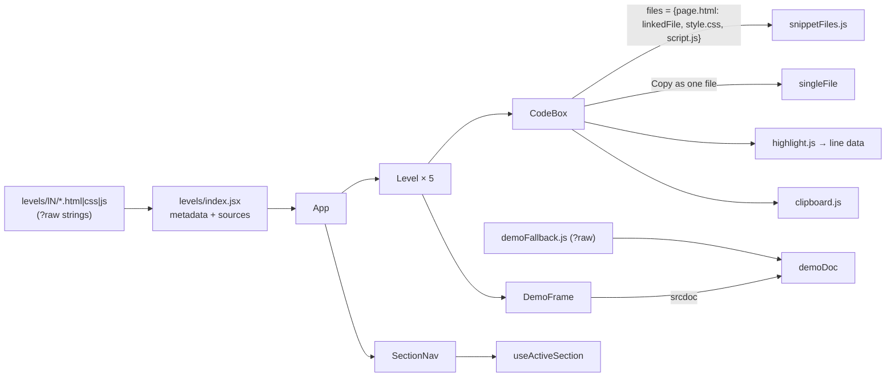

# refactor: Rebuild JavaScript Snippets page as a Vite + React app

## Overview

Today the project is one hand-written file, `JavaScript Snippet Levels.html` (~2,100 lines): inline CSS, five lesson sections, each level's demo source stored in ``, but a free-standing snippet file can, and one would break `demoDoc` and `singleFile` without any error. Guard this with a test.
- `highlight(code)` returns line records. A comment line is one whose trimmed text starts with `//`, `/*` or `<!--`. An empty line becomes a single space.

**Patterns to follow:**
- The page script in `JavaScript Snippet Levels.html` (lines 1975–2030).

**Test scenarios:**
- Happy path (parity): for each of l1–l5, `linkedFile(normalise(html), title)` equals `fixtures/lN/page.html`. `normalise(css)` and `normalise(js)` equal the fixture CSS/JS. `singleFile(...)` equals `fixtures/lN/single.html`. 20 assertions, table-driven.
- Happy path: `indent("a\n\nb", "  ")` → `"  a\n\n  b"` (empty lines stay unpadded).
- Edge case: `normalise("\n\n   \n  const a = 1;\n\n")` → `"  const a = 1;"`. All leading whitespace-only lines go, trailing whitespace goes, and the first code line's indentation stays.
- Edge case: CRLF input to `normalise` (`"a\r\nb\r\n"`) → `"a\nb"`, with no `\r` left.
- Error path (guard): no level's html/css/js source contains `</script` (case-insensitive).
- Edge case: the `demoDoc` output contains the fallback script before the snippet CSS.
- Happy path (highlight): `"// note"`, `"  /* x */"`, `"<!-- y -->"` → `isComment: true`. `"const a = 1; // trailing"` → `isComment: false`.
- Edge case (highlight): an empty line yields text `" "`. Text with `<b>` comes back as literal text (escaping is React's job; the record holds the raw text).
- Integration: the level data has 5 entries with keys `l1`…`l5` in order, and each has non-empty html/css/js sources.

**Verification:**
- All parity tests pass against fixtures generated from the original page.

---

- [x] **Unit 4: Port global CSS and static shell components**

**Goal:** Header, hero, strip and the static parts of each level render with the original look.

**Requirements:** R2

**Dependencies:** Unit 3

**Files:**
- Create: `src/styles/global.css`
- Create: `src/components/TopNav.jsx`, `src/components/Hero.jsx`, `src/components/Strip.jsx`, `src/components/Footer.jsx`, `src/components/Level.jsx`
- Modify: `src/App.jsx`, `src/main.jsx`
- Test: `tests/Level.test.jsx`

**Approach:**
- Copy the `<style>` block verbatim into `global.css`, including the VOICE/IDEA design-notes comment. Import it once in `main.jsx`.
- JSX conversion: `class` → `className`. The SVG `<use href>` stays (React supports `href` on `use`). `aria-*` props stay as-is. `&amp;` text becomes a plain `&` in JSX.
- `Level` renders the `<section className="level" id="level-N">` structure from the data. The difficulty meter renders N filled `<i>` elements out of 5. `CodeBox` and `DemoFrame` sit in slots (placeholder `div`s until Unit 5).
- External nav links stay plain `<a href>` to it55exp.netlify.app. The "Snippets" link keeps `aria-current="page"`.
- The levels render inside `<main>`. `Footer` carries the original disclaimer text. The anchor ids `top` and `level-1`…`level-5` exist for the nav links.

**Test scenarios:**
- Happy path: an l4 Try-it item renders `escapeHTML()` and `<b>Ana</b>` inside `<code>` elements. The `<b>` must show as literal text, not as bold markup.
- Happy path: the l5 learn chips include the literal text `<dialog>`.
- Happy path: rendering `Level` with l3 data gives heading "Add to cart", difficulty "Medium", 3 of 5 meter items with class `on`, 6 learn chips, and section id `level-3`.
- Happy path: the l3 intro renders `renderCart()` inside a `<code>` element (the JSX intro kept its markup).
- Edge case: the l1 meter has exactly one `on` item, and the l5 meter has the l5 count from the data.

**Verification:**
- Side by side with the original file in a browser at desktop and mobile widths, and in light and dark OS themes: no visible difference in header, hero, strip or level text blocks.

---

- [x] **Unit 5: Interactive pieces: CodeBox, DemoFrame, SectionNav**

**Goal:** Rebuild all the interactive behaviour (R4) as components.

**Requirements:** R3, R4

**Dependencies:** Unit 4

**Files:**
- Create: `src/components/CodeBox.jsx`, `src/components/DemoFrame.jsx`, `src/components/SectionNav.jsx`
- Create: `src/hooks/useActiveSection.js`, `src/lib/clipboard.js`
- Modify: `src/components/Level.jsx`, `src/App.jsx`
- Test: `tests/CodeBox.test.jsx`, `tests/DemoFrame.test.jsx`, `tests/SectionNav.test.jsx`

**Approach:**
- **CodeBox**: the `files` map is memoised from the level sources. State: the current file name and the copy-button labels. The tablist (`aria-label="${title} files"`), tabs, `aria-selected` and ids match the original (`l1-tab-0` etc.). ArrowLeft/Right wrap around and move focus to the new tab. The `<pre tabIndex=0 aria-live="polite">` scrolls to the top on tab change. The line count shows "N lines". "Copy this file" copies `files[current]`; "Copy as one HTML file" copies `singleFile`.
- **clipboard.js**: `copyText(text, preEl)` returns `ok`. It tries the clipboard API, then the textarea fallback, then (if `preEl` is given and both failed) selects the pre's contents. The label mapping and per-button timers are as described under Key Technical Decisions. Clear the timers on unmount.
- **DemoFrame**: browser chrome (dots + URL label) and an iframe with `title="Level N live demo"`. `srcdoc` is set from `demoDoc(...)` through a ref. On load: disconnect any old observer. If `fixedHeight` is set, apply it and stop. Otherwise fit the height to the body (clamped 220–1600px) and observe the body. If `contentDocument` throws, use 560px. The "↻ Reset demo" button in the lab top bar reassigns `srcdoc` on the same element. `Level` owns a reset signal or callback, so the button and the iframe stay where they are in the markup.
- **SectionNav + useActiveSection**: observe the five `.level` sections with the same rootMargin. The active id starts as `null`, so no link has `on`. Update it only on entries that are intersecting, and never clear it when a section exits, which matches the original's `continue` on non-intersecting entries. Links get class `on` when active. Clean up the observer on unmount.

**Patterns to follow:**
- The page script in `JavaScript Snippet Levels.html` (lines 2032–2108) for exact behaviour, labels and numbers.

**Test scenarios:**
- Happy path (CodeBox): the first tab `page.html` is selected at the start, and the code shows the linked page. Clicking `script.js` selects it, sets `aria-selected` true only on that tab, and the line count matches the fixture's line count.
- Happy path (CodeBox keyboard): ArrowRight on the last tab wraps to `page.html` and focuses it. ArrowLeft on the first tab wraps to `script.js`.
- Happy path (copy): with `navigator.clipboard.writeText` mocked to resolve, clicking "Copy this file" calls it with the current file's exact string, and the button reads "Copied". After 1.6s (fake timers) it is back to "Copy this file".
- Happy path (copy all): "Copy as one HTML file" is called with a string equal to `fixtures/lN/single.html`.
- Error path (copy): clipboard rejects and `execCommand` returns false → the label reads "Selected: press Ctrl+C", and the window selection covers the `<pre>`.
- Error path (copy): clipboard rejects and `execCommand('copy')` returns true → the label reads "Copied", and the temporary textarea is removed from the DOM.
- Edge case (copy): click "Copy this file", then click it again 1s later → the label is still "Copied" at 1.6s after the first click, and back to the default at 1.6s after the second. "Copy as one HTML file" keeps its own label and is unaffected.
- Happy path (CodeBox a11y): the tablist has `aria-label="Level 1 - Button Clicks files"`.
- Happy path (DemoFrame): the iframe `srcdoc` equals `demoDoc(normalised html, css, js)` for the level, and the iframe has `title="Level 3 live demo"` for l3.
- Integration (DemoFrame reset): clicking "Reset demo" keeps the **same** iframe element (identity check), reassigns `srcdoc`, and the old ResizeObserver is disconnected (the stubbed observer records `disconnect`).
- Edge case (DemoFrame sizing): a stubbed body `scrollHeight` of 100 → height 220px; 5000 → 1600px; `contentDocument` access throws → 560px.
- Edge case (DemoFrame fixed height): l5 with `fixedHeight: 640` → height 640px after load, and no ResizeObserver is created.
- Happy path (SectionNav): when the stubbed IntersectionObserver reports `level-4` intersecting, the "04 Checkout" link gets class `on` and the others do not.
- Edge case (SectionNav): no link has `on` at first. After `level-4` intersects and then reports not intersecting, "04 Checkout" keeps `on`.
- Edge case (SectionNav): unmounting `App` disconnects the observer.

**Verification:**
- In a real browser: every level's demo works (clicks, likes, cart, checkout form, mini shop with localStorage persisting across reload). Images fall back to drawings when Unsplash is blocked. Copy pastes the exact text. Nav highlight follows scrolling.

---

- [x] **Unit 6: Parity sign-off and switch fixtures to snapshots**

**Goal:** Confirm full parity, then turn the one-time parity check into a long-term guard that can be updated, so snippets stay editable (R5).

**Requirements:** R1–R5

**Dependencies:** Unit 5

**Files:**
- Modify: `tests/parity.test.js` (compare against Vitest file snapshots instead of the frozen fixtures)
- Move: `tests/fixtures/**` → the snapshot location the file-snapshot matcher uses (exact path decided at implementation)
- Modify: `tests/fixtures/README.md` → `tests/SNAPSHOTS.md` (the fixtures came from the original page; after a deliberate snippet edit, run the tests in update mode and review the snapshot diff, which is exactly what students will copy)
- Create: `README.md` (how to run, test and build, where snippet sources live, the snapshot update workflow, and the rule that snippets stay vanilla JS)
- Keep: `JavaScript Snippet Levels.html`. It is **not** deleted in this plan (user decision).

**Approach:**
- Run the `dist/` build through `vite preview` and compare it with the original side by side, covering every R4 behaviour once.
- Before switching, confirm that the parity test passes against the original fixtures **unchanged**. Then seed the snapshots from those same bytes. Do not regenerate them from the new code, so the first snapshot is the original page's output.
- Switch `parity.test.js` to Vitest's file-snapshot matcher, one snapshot per level per output (20 in total).
- The legacy HTML stays in the repo, as a fallback that works anywhere without a server, until the React build is deployed and checked on the real host. Removing it is part of the deferred deployment task.

**Test scenarios:**
- Happy path: with no snippet changes, all 20 snapshot assertions pass, and the snapshot bytes equal the Unit 2 fixtures.
- Integration: a test-only change of one character in `src/levels/l1/script.js` fails the `script.js` and `single.html` snapshots for l1 only. Running in update mode rewrites only those two files. Revert the change afterwards.

**Verification:**
- The full test suite is green. The build output is a static `dist/` that works through `vite preview`. The README steps work on a fresh `npm install`. The legacy file is still present.

## System-Wide Impact

- **Interaction graph:** CodeBox and DemoFrame both read from the same level sources and `snippetFiles.js`. A change to a snippet file updates the shown code, the copied code and the live demo together, as it does now.
- **State lifecycle risks:** The level 5 demo writes `localStorage['campusShopCart']`. The srcdoc iframe shares the host origin, so this key lives on the app's origin. The behaviour is the same as today, but the origin changes (localhost:5173 in dev, and whatever host is chosen later), so carts saved under the old file:// origin will not carry over. Acceptable.
- **API surface parity:** The copy outputs are the "public contract" students use. The fixtures guard them.
- **Unchanged invariants:** Snippet HTML/CSS/JS content, external links, and the CSS class names and design tokens.

## Risks & Dependencies

| Risk | Mitigation |
|------|------------|
| **The current git repo root is the whole user home folder (`C:/Users/63905`)**. Commits there could sweep in personal files, `.ssh/`, `.claude.json` and others. The current branch `mere-real` is also showing many deleted `geojsons` files from another project. | Unit 1 creates a separate repo in this project folder, with the user's confirmation. Nothing is staged or committed in the home repo. The home repo will then see this folder as a nested repo; cleaning that up is out of scope and left for the user to decide. |
| Byte-level drift in the copy output (whitespace, CRLF on Windows with `core.autocrlf=true`, a `</script>` inside a snippet) | Fixtures from the original page plus table-driven parity tests (Unit 3). `.gitattributes` (Unit 1) keeps files LF on checkout. `normalise` converts CRLF to LF, which covers editors that save files as CRLF. A guard test checks for `</script`. |
| Lost markup when moving intros to JSX | Unit 4 tests check `<code>` inside the intro. Visual side-by-side check. |
| jsdom has no ResizeObserver / IntersectionObserver | Stub both in tests. The real behaviour is checked in a browser in Units 5 and 6. |
| Vite dev-server path with spaces in the folder name | Known to work. If it misbehaves, the fix is to rename the folder (user's call). |

## Documentation / Operational Notes

- The README covers run/test/build and the rule that snippets stay vanilla.
- Deployment (for example Netlify: build `npm run build`, publish `dist`) is deferred until the hosting target is confirmed.

## Sources & References

- Source: `JavaScript Snippet Levels.html` (whole file read during planning)
- User decision: React shell only; snippets unchanged

## Implementation Notes (2026-11-25)

Where the build differs from the plan text above:

- **No git** (user decision at the start of work). The Unit 1 `git init` and baseline commit were skipped. `.gitattributes` was still added for later use. Because there is no diff to review, the work had an inline self-review instead of the multi-agent review.
- **Versions:** Vite 8, React 19, @vitejs/plugin-react 6, Vitest **4** and jsdom **28**. Vitest 5 and jsdom 31 need Node 22, and this machine runs Node 20.19.
- **Snippet body file is `body.html`**, not `page.html`, to avoid confusing it with the full `page.html` tab students copy.
- **Fixtures also include `demo.html`** (the iframe document) for every level, which closes the reviewer gap that demo output had no fixture. That makes 25 snapshot files, not 20.
- **Level 5 extras found during the port:** its lab label adds " · refresh keeps your cart", and its button reads "↻ Refresh demo". Both are stored as `labNote` and `resetLabel` in the level data.
- **Vitest config:** `css.include` covers `src/levels/` because Vitest skips CSS by default, which made the `style.css?raw` imports empty.
- **Fixtures are the snapshots in place** (`toMatchFileSnapshot('./fixtures/...')`). They were not moved to a separate snapshot folder. Update them with `npm run test:update`.
- **Checks run:** 65 tests pass. On the production build (`vite preview`), all 25 outputs were hashed in Chrome and match the fixtures. Demos run, reset reuses the same iframe and keeps its height, level 5 is pinned at 640px, product images load, the nav highlights the section in view, and there are no console errors. Editing `l1/script.js` on purpose failed only l1's script.js, single.html and demo.html snapshots; the edit was then reverted.
